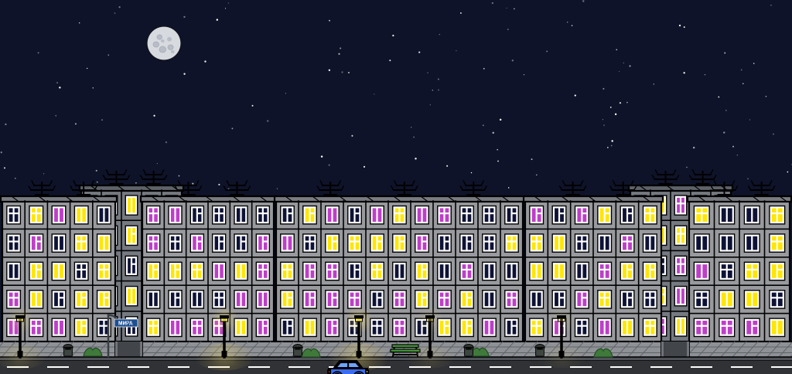

# Проект: Компьютерная графика — Задача №1 (Городской пейзаж)

## 🏙️ Описание проекта
Проект представляет собой осмысленную графическую композицию ночного микрорайона панельных хрущёвок с дорогой, периодически проезжающим автомобилем, мерцающими фонарями, лавочкой, урнами, зелёными кустами, уличной табличкой и ночным небом с Луной и звёздами. Рисунок вдохновлён советской городской эстетикой и выполнен строго на примитивах векторной графики.



## 🧱 Использованные графические примитивы
В проекте задействованы графические примитивы:
- **Прямоугольники (`fillRect`, `strokeRect`)**: фасадные панели хрущёвок, парапеты крыш, оконные ниши и рамы, опора и козырёк фонаря, лампа, тротуар, бордюр, проезды во дворы, доски лавочки, корпус урны, кузов и фары автомобиля.
- **Прямые линии (`strokeLine`)**: межпанельные швы, переплёты окон, телеантенны на крышах, штрихи парапета, швы тротуарной плитки, прерывистая дорожная разметка, ножки лавочки, мачта фонаря, столб таблички, края проездов.
- **Кривые линии (`bezierCurveTo`)**: зелёные кусты на тротуаре и изогнутый кронштейн уличной таблички.
- **Эллипсы и окружности (`fillOval`, `strokeOval`)**: Луна, лунные кратеры, звёзды, шины и диски колёс автомобиля.
- **Дуги (`fillArc`, `strokeArc`, `ArcType.CHORD`/`ArcType.OPEN`)**: куполообразная крышка урны и колёсные арки кузова автомобиля.
- **Многоугольники (`fillPolygon`, `strokePolygon`)**: кабина со скошенными стойками и стёкла автомобиля.
- **Текстовые надписи (`fillText`, `Font`)**: название улицы «МИРА» на уличной табличке.
- **Градиенты (`RadialGradient`, `Color.rgb` с альфа-каналом)**: радиальный ореол вокруг лампы фонаря и световое пятно на тротуаре, пульсирующие синхронно с мерцанием лампы.

---

## 🏛️ Объектно-ориентированная архитектура
Рисование инкапсулировано в собственную объектную модель:
- [`Drawable`](file:///d:/kgtask1/src/main/java/ru/vsu/cs/kg/model/Drawable.java): базовый интерфейс отрисовки с методом `draw(GraphicsContext gc, double elapsedTimeSeconds)`.
- [`Sky`](file:///d:/kgtask1/src/main/java/ru/vsu/cs/kg/model/Sky.java): фон неба, фиксированная Луна с кратерами и процедурно генерируемые мерцающие звёзды.
- [`WindowElement`](file:///d:/kgtask1/src/main/java/ru/vsu/cs/kg/model/WindowElement.java): окно дома со случайной одной из 3 форм переплёта (одна вертикальная планка, полный крест, крест без левой половины горизонтали) и одним из 3 цветов стекла (тёмно-синий, фиолетовый, жёлтый).
- [`Khrushchevka`](file:///d:/kgtask1/src/main/java/ru/vsu/cs/kg/model/Khrushchevka.java): фасад панельного дома — сетка панелей со швами, окна, парапет и антенны; дома заднего плана темнее.
- [`Lantern`](file:///d:/kgtask1/src/main/java/ru/vsu/cs/kg/model/Lantern.java): фонарный столб со случайным мерцанием лампы и синхронно пульсирующим светом на земле.
- [`Driveway`](file:///d:/kgtask1/src/main/java/ru/vsu/cs/kg/model/Driveway.java): проезд во двор — пара горизонтальных границ и его ширина.
- [`ForegroundEnvironment`](file:///d:/kgtask1/src/main/java/ru/vsu/cs/kg/model/ForegroundEnvironment.java): тротуарная плитка, бордюр, дорога с разметкой, проезды во дворы, кусты, скамейка и урны.
- [`StreetSign`](file:///d:/kgtask1/src/main/java/ru/vsu/cs/kg/model/StreetSign.java): уличная табличка на столбе с изогнутым кронштейном и названием улицы.
- [`Car`](file:///d:/kgtask1/src/main/java/ru/vsu/cs/kg/model/Car.java): автомобиль, периодически проезжающий по дороге.
- [`CityscapeModel`](file:///d:/kgtask1/src/main/java/ru/vsu/cs/kg/model/CityscapeModel.java): компоновщик сцены — собирает слои в порядке отрисовки, хранит раскладку домов и вычисляет проезды во дворы по зазорам между ними.
- [`MainApp`](file:///d:/kgtask1/src/main/java/ru/vsu/cs/kg/MainApp.java): JavaFX-окно с канвой 1024×484, масштабируемой с сохранением пропорций; полноэкранный режим (F11) с letterbox; таймер кадров и обработка ввода.
- [`Launcher`](file:///d:/kgtask1/src/main/java/ru/vsu/cs/kg/Launcher.java): стартовый класс для запуска из IDE без ошибки «JavaFX runtime components are missing».

## 🕹️ Управление
- **ЛКМ по окну дома** — сменить форму этого окна; **ЛКМ мимо домов** — сменить форму всех окон сразу.
- **ПКМ**, клавиша **W** или **пробел** — сменить форму сразу всех окон.
- Клавиша **R** — перегенерация города (новые окна и звёзды).
- Окно можно свободно растягивать и разворачивать (минимальный размер — 640×360): сцена вписывается с сохранением пропорций, а свободное место заполняется чёрными полями. **F11** включает полноэкранный режим (Esc или F11 — выход).

## 🚀 Запуск проекта
Проект собирается с помощью Maven и запускается командой:
```bash
mvn javafx:run
```
или сборка без запуска:
```bash
mvn clean compile
```
